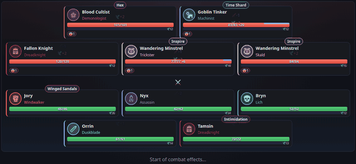
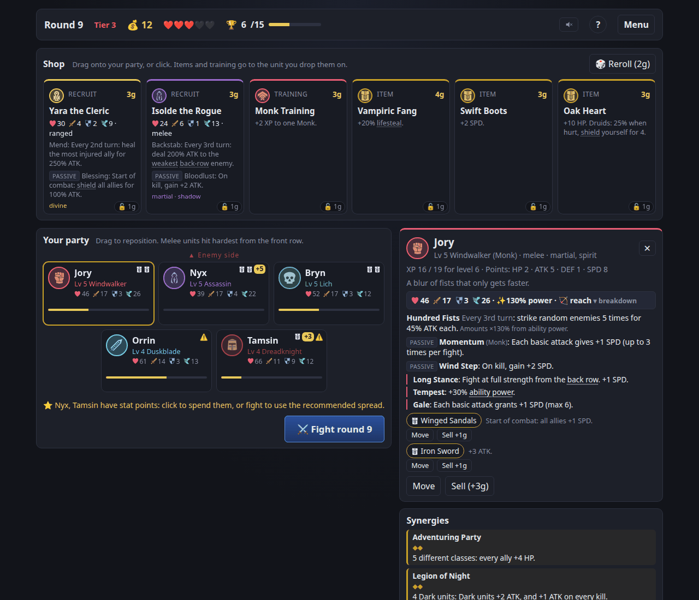
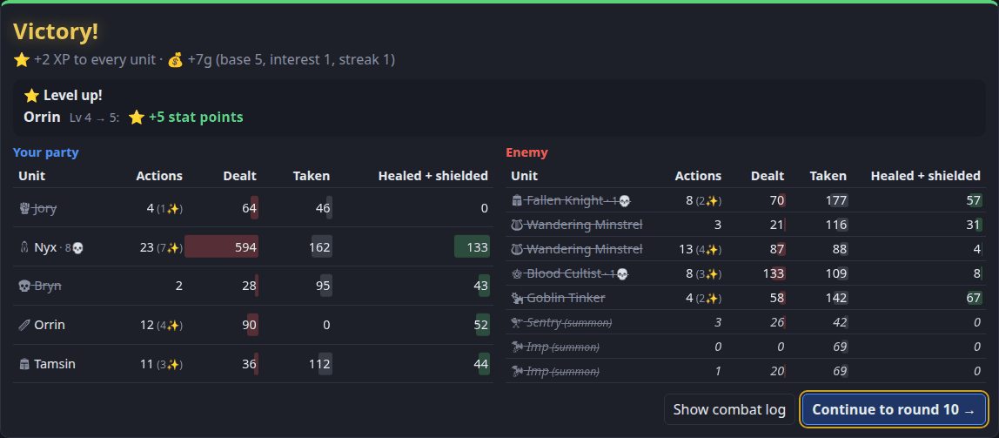
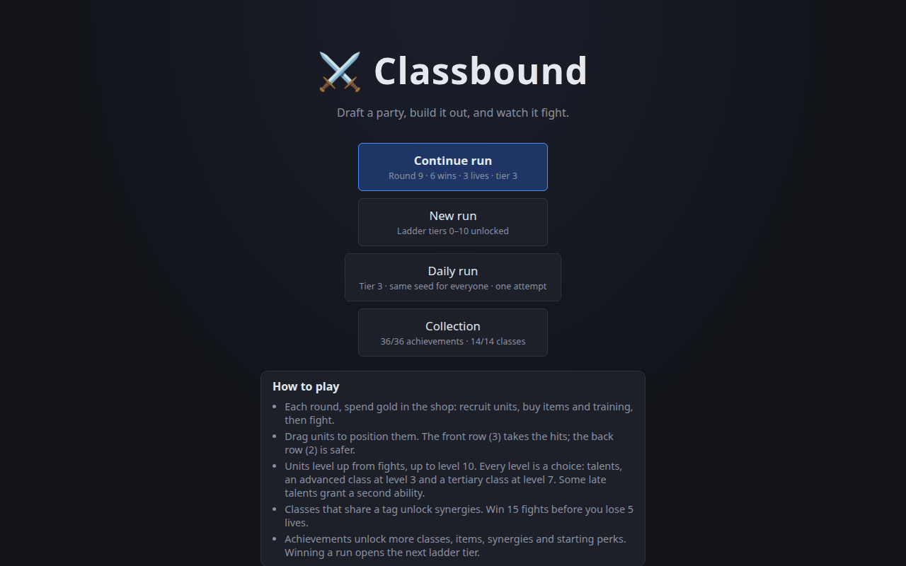
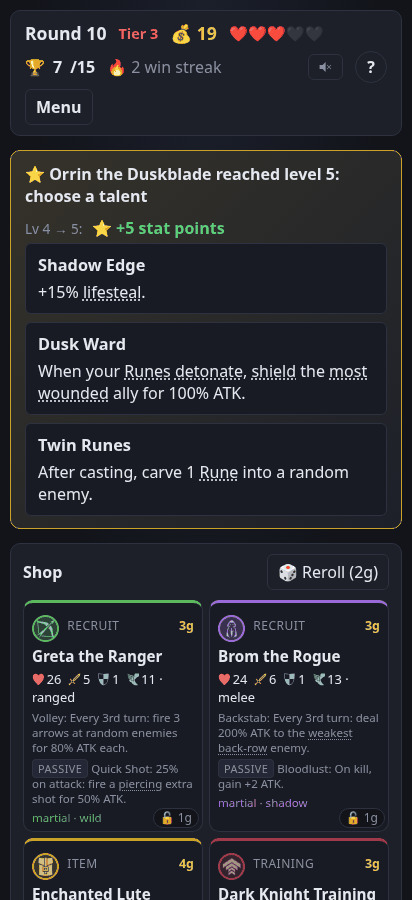

# Classbound

A browser-playable party auto-battler with RPG classes and builds. You draft a party, position it, equip it and level it up between rounds, then the fight resolves on its own. Think Super Auto Pets or Backpack Battles, with the depth coming from CRPG-style classes, talent choices and advanced-class upgrades.

**[▶ Play in your browser](https://aggrosec.github.io/party-auto-battler/)**. It works on phones too, and needs no install or account.



## The game

- **Draft and position.** Each round you spend gold in the shop on recruits, items and training, then place your party of five in a front row of three and a back row of two. Melee units hit hardest from the front; the back row is safer.
- **Build every unit.** Units level up to 10. Every level is a choice: a talent from the class's pool, stat points you spend yourself, an **advanced class** at level 3 and a **tertiary class** at level 7. Some late talents grant a second ability.
- **Watch it fight.** Combat is fully automatic and deterministic: a tick timeline driven by speed, played back turn by turn with pause, 2x and skip, then a per-unit summary.
- **Synergies and items.** Class tags and specific pairs unlock party synergies; every tertiary class has a signature item worth chasing.
- **Meta progression.** Achievements unlock classes, items, synergies and starting perks. Winning a run opens the next of 10 ladder tiers, with Elites and bosses higher up. There's also a daily run with the same seed for everyone.

| | |
|---|---|
|  |  |
|  |  |

**In 1.0:** 14 classes (5 to start, 9 to unlock), 28 advanced and 56 tertiary classes, 393 talents, 89 items (56 of them signature items), 22 synergies, 14 starting perks, 36 achievements, a 10-tier difficulty ladder with 6 bosses, game-icons.net art, and retro sound effects synthesised in the browser.

## Running locally

Requires Node 22.12+ (Node 24 LTS recommended, matching CI).

```sh
npm install
npm run dev     # play locally (dev builds add the combat lab and an Unlock everything toggle to the title screen)
npm run check   # typecheck + lint + tests
npm run sim     # headless balance simulator
npm run playlog # replay play logs recorded by npm run dev (playlogs/)
npm run icons   # re-fetch the game-icons.net icons and regenerate their credits
npm run build   # production build
```

**Export play log** on the title screen saves your recent runs as a file that `npm run playlog -- <file>` can replay.

## Project layout

```
src/engine/   pure, deterministic game logic (no DOM, no Math.random, no Date)
src/data/     classes, talents, items, enemies and achievements as typed data
src/sim/      headless balance simulator and bots, play-log replay, icon fetcher
src/ui/       React UI (src/ui/audio: sound effects)
src/assets/   icons (generated) and ATTRIBUTION.md
docs/         design doc, decision log, checkpoints, balance reports, README media
```

## How this was built

**Brandon designed and directed this project. [Claude Code](https://claude.com/claude-code) wrote the code**: the engine, content, UI, simulator, tests and docs. Brandon set the direction, designed the later classes (Runeblade, Dark Knight, Cultist), playtested every milestone on desktop and phone, and reviewed and merged every pull request.

The process is part of the showcase, and all of it is in this repository:

- **[CLAUDE.md](CLAUDE.md):** the project brief and working agreement Claude Code follows. It covers architecture rules, the git workflow, and the milestone plan.
- **Milestones, one pull request each.** Work happened on branches; each milestone ended with a checkpoint summary and a PR that Brandon reviewed and merged. Claude Code never merged its own work or committed to `main`. In all: 9 milestones plus playtest follow-ups, 17 pull requests by 1.0, and CI (typecheck, lint, tests, build) on every one.
- **[docs/CHECKPOINTS.md](docs/CHECKPOINTS.md):** each milestone's summary. It covers what was built, what to playtest, known issues and simulator numbers.
- **[docs/DESIGN.md](docs/DESIGN.md):** the living design doc, including every class, talent and signature item.
- **[docs/DECISIONS.md](docs/DECISIONS.md):** every decision Claude Code made on its own, dated, with reasoning. Design changes a player would notice were asked about first instead.
- **[docs/BALANCE.md](docs/BALANCE.md):** headless simulator reports. Four bot strategies play thousands of full runs, and numbers were tuned against them *before* each playtest, from the first economy pass to the Cultist's three tuning passes.
- **Playtest loop.** The game records play logs that Brandon exported after his sessions. Claude Code replayed them with `npm run playlog` to diagnose issues: a repeated-talent bug, accidental sells while scrolling on a phone, and where the ladder felt easy. Each fix became a small PR.
- **Tests:** 325 (Vitest), covering every engine rule, the content's integrity, and the UI's pure logic. The engine is deterministic: the same seed and inputs always give the same fight.

## Credits

Icons from [game-icons.net](https://game-icons.net) by Lorc, Delapouite, Skoll, Sbed and Cathelineau, under [CC BY 3.0](https://creativecommons.org/licenses/by/3.0/). Each icon is listed in [src/assets/ATTRIBUTION.md](src/assets/ATTRIBUTION.md) and on the in-game Credits screen. Sound effects are synthesised in code; everything else is drawn in CSS and SVG.
